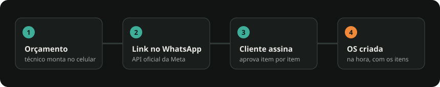

<!-- HEADER -->
<p align="center">
  
</p>

<p align="center">
  
</p>

<p align="center">
  
</p>

<p align="center">
  
  
  
  
  
</p>

<p align="center">
  
</p>

Oi! Este é o repositório do **Prumo**, nosso SaaS para oficinas mecânicas pequenas (2 a 10 pessoas).
Este README explica, sem enrolação, **o que é o projeto** e **como colocar ele pra rodar no seu computador**.

---

## 🧰 Stack

<p align="center">
  
</p>

---

## O que o sistema faz (por enquanto)

Estamos construindo só o **core** primeiro. Hoje ele faz duas coisas:

1. **Orçamento → aprovação → OS**
   O técnico monta o orçamento pelo celular e manda o link pro cliente (WhatsApp).
   O cliente abre o link, escolhe o que aprova, **assina com o dedo** na tela e pronto:
   a **Ordem de Serviço (OS)** é criada sozinha com os itens aprovados.
2. **OS direta**
   Para quando o cliente chega e já quer fazer o serviço, sem orçamento.

A OS é o coração de tudo: cliente, veículo, itens, valores e qual técnico fez cada coisa.
Estoque, nota fiscal, lembretes etc. ficam para depois.

---

## Como o projeto está dividido

| Pasta | O que tem lá |
|---|---|
| `backend/` | A API (Laravel/PHP). Regras de negócio e banco de dados. |
| `frontend/` | O app que a oficina e o cliente usam (React). Funciona no celular. |
| `worker-whatsapp/` | Serviço Node que envia as mensagens de WhatsApp pela API oficial da Meta. Ver `worker-whatsapp/README.md`. |
| `docker/` e `docker-compose.yml` | Configuração pra rodar banco e API sem instalar PHP/Postgres na máquina. |
| `modules/` | Uma explicação de cada parte do sistema (orçamentos, OS, clientes...). |
| `docs/` | Arquitetura, decisões técnicas (`adr/`) e a marca (`brand/`). |
| `CLAUDE.md` | As regras do projeto. Vale ler quando for mexer no código. |

Resumindo: **o Docker roda o backend + banco**, e **o frontend roda direto com Node**.

---

## Passo a passo para rodar

### 1. Instale o que precisa (só uma vez)

- **Git** — https://git-scm.com
- **Docker Desktop** — https://www.docker.com/products/docker-desktop
  Depois de instalar, abra o Docker Desktop e deixe ele ligado (ícone da baleia).
- **Node.js 22 (LTS)** — https://nodejs.org

Pra conferir se deu certo, abra um terminal e rode:

```bash
docker --version
```

```bash
node --version
```

Se os dois mostrarem um número de versão, está tudo certo.

### 2. Baixe o projeto

```bash
git clone https://github.com/vslongo/prumo.git
```

```bash
cd prumo
```

> Se o repositório for privado, o Git vai pedir pra você entrar na sua conta do GitHub (abre o navegador).
> Você precisa ter sido adicionado como colaborador no repositório.

### 3. Crie o arquivo de configuração do backend

O backend lê as configurações de um arquivo `.env`, que **não vai pro Git** (tem segredos).
Copie o exemplo:

```bash
cp backend/.env.example backend/.env
```

Depois abra o `backend/.env` num editor e troque esta linha:

```
R2_DRIVER=s3
```

por:

```
R2_DRIVER=local
```

> Isso faz as assinaturas dos clientes ficarem salvas no seu computador em vez de ir pra nuvem.
> O resto do arquivo já vem pronto para rodar local.

### 4. Suba o banco de dados

```bash
docker compose up -d pgsql redis
```

Na primeira vez demora um pouco (ele baixa as imagens).

### 5. Prepare o backend (só na primeira vez)

```bash
docker compose run --rm app composer install
```

```bash
docker compose run --rm app php artisan key:generate
```

```bash
docker compose run --rm app php artisan migrate --seed
```

```bash
docker compose run --rm app php artisan db:seed --class=DemoSeeder
```

O que cada um faz, em português:
- `composer install` → baixa as bibliotecas do PHP.
- `key:generate` → cria a chave de segurança da aplicação.
- `migrate --seed` → cria as tabelas e os tipos de serviço padrão (troca de óleo, junta...).
- `DemoSeeder` → cria uma **oficina de demonstração** com usuários prontos pra testar.

> **Usando Git Bash no Windows?** Se der erro estranho de caminho, coloque `MSYS_NO_PATHCONV=1` antes do comando.
> Ex.: `MSYS_NO_PATHCONV=1 docker compose run --rm app php artisan migrate --seed`

### 6. Ligue a API

```bash
docker compose up -d app queue
```

- `app` é a API, que fica em http://localhost:8000
- `queue` é o "ajudante" que roda tarefas em segundo plano. **Sem ele, a OS não é criada depois que o cliente aprova o orçamento.**

### 7. Ligue o frontend

Em outro terminal:

```bash
cd frontend
```

```bash
npm install
```

```bash
npm run dev
```

Abra **http://localhost:5173** no navegador. 🎉

### 8. Entre no sistema

Use um dos usuários da oficina demo:

| Quem | E-mail | Senha |
|---|---|---|
| Dono da oficina | `dono@demo.test` | `password` |
| Técnico | `tecnico@demo.test` | `password` |

**Teste rápido do fluxo principal:** entre como técnico → crie um orçamento → envie →
abra o link gerado numa aba anônima (como se fosse o cliente) → aprove e assine →
volte pro sistema e veja a OS criada.

---

## No dia a dia

Depois da primeira vez, pra voltar a trabalhar basta:

```bash
docker compose up -d pgsql redis app queue
```

e, na pasta `frontend`:

```bash
npm run dev
```

Pra desligar tudo:

```bash
docker compose down
```

(Os dados do banco **não** se perdem com isso.)

---

## Rodando os testes

Backend:

```bash
docker compose run --rm app php artisan test
```

Cobertura de `Actions/` e `Enums/` (o CI exige 90%). Na primeira vez depois desta mudança, recrie a imagem com `docker compose build app`:

```bash
docker compose run --rm app php -d extension=pcov.so vendor/bin/pest --coverage --min=90
```

Frontend (dentro de `frontend/`):

```bash
npm test
```

Testes de ponta a ponta no navegador (dentro de `frontend/`). **Atenção: isso apaga e recria o banco de dev.**

```bash
npx playwright install chromium
```

```bash
npm run e2e
```

Worker do WhatsApp (dentro de `worker-whatsapp/`):

```bash
npm test
```

---

## Deu problema?

| Sintoma | O que fazer |
|---|---|
| `Cannot connect to the Docker daemon` | O Docker Desktop não está aberto. Abra e espere ele ficar verde. |
| `port is already allocated` (8000, 5173 ou 5433) | Algum outro programa está usando essa porta. Feche ele ou pare outros containers. |
| Tela de login não entra / erro 419 | Acesse pelo `http://localhost:5173` (não pelo `127.0.0.1`) e confira se a API está de pé (`docker compose ps`). |
| Cliente aprovou mas a OS não apareceu | O serviço `queue` está desligado. Rode `docker compose up -d queue`. |
| `No application encryption key` | Faltou o passo 5 (`key:generate`). |
| Quero zerar o banco e começar do zero | `docker compose run --rm app php artisan migrate:fresh --seed` e depois o `DemoSeeder` de novo. |

Ver os logs da API:

```bash
docker compose logs -f app queue
```

---

## Quer entender mais a fundo?

- [`CLAUDE.md`](CLAUDE.md) — regras do projeto e do negócio (leitura obrigatória antes de codar).
- [`docs/architecture.md`](docs/architecture.md) — como as peças se conectam.
- [`backend/README.md`](backend/README.md) — lista de rotas da API.
- [`frontend/README.md`](frontend/README.md) — estrutura do app.
- [`modules/`](modules/) — explicação de cada módulo (Orçamentos, OS, Clientes...).
- [`docs/brand/BRAND.md`](docs/brand/BRAND.md) — a marca Prumo (cores, voz, logo).

<!-- FOOTER -->
<p align="center">
  
</p>
