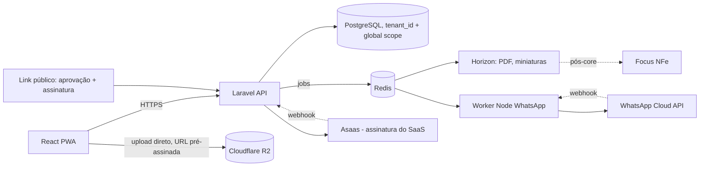
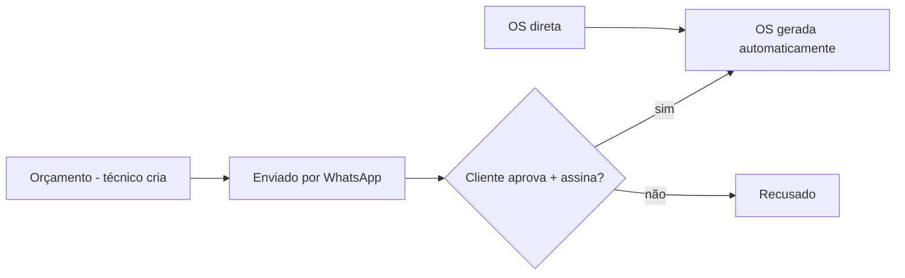
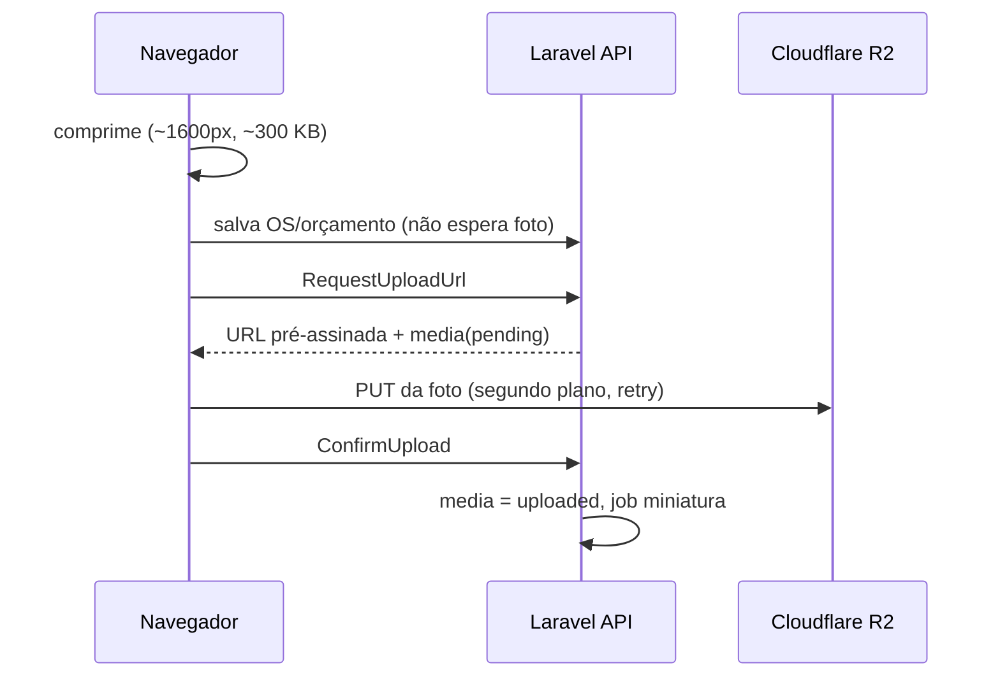
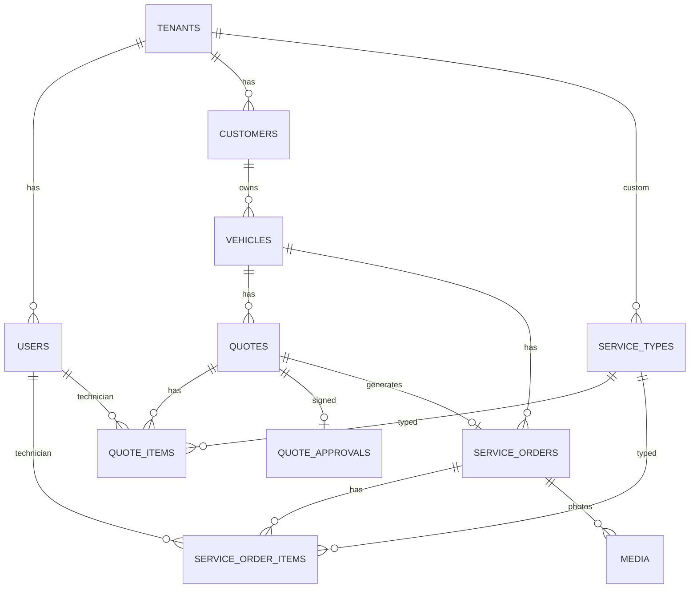

# Arquitetura

Core primeiro: orçamento → aprovação com assinatura → OS automática, e OS direta. A OS é o centro dos dados.
Multi-tenant: banco único + `tenant_id` + global scope do Laravel (RLS do Postgres é pós-core opcional).
Não usamos banco por empresa: seriam centenas de bancos pra migrar, monitorar e fazer backup.

## Visão geral

## Fluxo do core

## Upload de fotos

## Modelo de dados (core)

Pós-core: inspections/inspection_items, parts/stock_movements, invoices, reminders, payments, audit_logs, vehicles global + tenant_vehicles + vehicle_ownerships + vehicle_history.

Hospedagem: Hetzner CX33 + Laravel Forge + Postgres no mesmo VPS + Cloudflare R2 + Resend + Sentry. Ver Page "Arquitetura técnica: SaaS pra oficinas".

## Erros (Sentry)
Os três apps mandam erro para o Sentry só quando o DSN está configurado (`SENTRY_LARAVEL_DSN`, `VITE_SENTRY_DSN`, `SENTRY_DSN` do worker). Em dev fica vazio e nada sai da máquina.
Regra de LGPD (CLAUDE.md §10): **nenhum dado pessoal vai para o Sentry**.
- **Coleta automática desligada:** backend com `send_default_pii` falso e sem corpo da requisição; front e worker com `dataCollection` todo desligado. Sem replay nem tracing no front.
- **Filtro antes do envio:** backend em `App\Shared\Support\SentryScrubber`, front em `src/shared/lib/sentry.ts`. Os dois filtros:
  - deixam só o método e o caminho da requisição, sem query string (a busca de cliente leva telefone e CPF);
  - trocam o token dos links públicos (`/o/`, `/convite/`, `/public/quotes|invitations/`) por `[token]`;
  - deixam do usuário só o id.
- **Erro de banco:** no backend, a mensagem perde o SQL com os valores e a linha `DETAIL` do Postgres.
- **No front:** breadcrumbs de `console` são descartados.
- **Contexto:** o tenant vai como tag `tenant_id`, definida no `TenantContext`, então vale para requests e jobs.
- **No worker:** só os logs de nível `error` viram evento, e eles já saem com o telefone mascarado.
